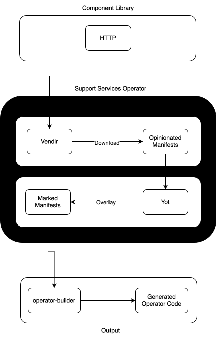

# Summary

The following is for developers and outlines how to:

1. [Add New Project](#add-new-project)
2. [Upgrade Existing Project](#version-upgrade)
3. [Regenerate the Operator](#regenerate-the-operator)

The source manifests for each project in this operator are vendored from the
[platform-component-library](https://github.com/nukleros/platform-component-library),
then overlaid with [operator-builder](https://github.com/nukleros/operator-builder)
markers to produce the manifests used to generate the operator code.

All `make` commands in this document are run from the `.operator-builder`
directory.

```bash
cd .operator-builder
```


## Diagram




## Add New Project

To add a new project, first add the necessary sub-directories and files in the
`.operator-builder` directory.

```bash
export DOMAIN=<domain of the api, e.g. addons.nukleros.io>
export GROUP=<group of the api, e.g. platform>
export KIND=<component the project belongs to, e.g. certificates-component>
export PROJECT=<some project, e.g. cert-manager>
make project
```

This creates a scaffold structure at `.operator-builder/$GROUP.$DOMAIN/$KIND/$PROJECT`.


### Download From Upstream

Write your vendir file at `$GROUP.$DOMAIN/$KIND/$PROJECT/config/vendor.yaml`

See https://carvel.dev/vendir/docs/v0.46.x/vendir-spec/.  This
file points at the upstream (typically a tagged release of the
platform-component-library) and "vendors" the manifests locally into
`$GROUP.$DOMAIN/$KIND/$PROJECT/vendor`.

```bash
make download
```

### Overlay Operator Builder Markers

Write your YOT overlay instructions at `$GROUP.$DOMAIN/$KIND/$PROJECT/config/overlays.yaml`
and any values they reference at `$GROUP.$DOMAIN/$KIND/$PROJECT/config/values.yaml`.

The YOT overlay instructions add the operator-builder markers to the vendored
manifests and produce the final manifests in `$GROUP.$DOMAIN/$KIND/$PROJECT/manifests`.
Refer to other examples in this project, the [yaml-overlay-tool
docs](https://docs.yaml-overlay-tool.io/) and the [operator-builder markers
docs](https://github.com/nukleros/operator-builder/blob/main/docs/markers.md).

Unlike the platform-component-library, these overlays generally add
operator-builder markers, which make a value configurable on the custom
resource.  For example, to make the namespace configurable:

```yaml
commonOverlays:
  - name: "add namespace markers"
    query:
      - metadata.namespace
    value: "%v"  # +operator-builder:field:name=namespace,default="%v",type=string
```

```bash
make overlay
```

### Add To The Component

Add the output manifests to the `resources` list of the component's workload
config at `$GROUP.$DOMAIN/$KIND/workload.yaml`.  If this is a new component,
also add its `workload.yaml` to the `componentFiles` list in
`setup.addons.nukleros.io/workload.yaml`.

Then [regenerate the operator](#regenerate-the-operator).


## Version Upgrade

Following is an example of upgrading the cert-manager manifests.

First, update the `ref` for the cert-manager manifests in
`platform.addons.nukleros.io/certificates-component/cert-manager/config/vendor.yaml`.

Then you can sync the latest manifests as follows.

```bash
export DOMAIN=addons.nukleros.io
export GROUP=platform
export KIND=certificates-component
export PROJECT=cert-manager
make download
```

Next, apply the overlays.

```bash
make overlay
```

Now the manifests in the `platform.addons.nukleros.io/certificates-component/cert-manager/manifests`
directory will be updated to the version specified in
`platform.addons.nukleros.io/certificates-component/cert-manager/config/vendor.yaml`.

Then [regenerate the operator](#regenerate-the-operator).

> **NOTE:** be sure to review the output.  The upstream could have significantly changed
so each upgrade should be carefully reviewed.


## Regenerate the Operator

After changing any manifests or workload configs, regenerate the operator code:

```bash
make operator-update
```

> **WARN:** `operator-init` and `operator-create` only need to be run once when
> the operator is first created.  Use `operator-update` for all subsequent changes.

Then, from the root of the repository, regenerate the generated code and
manifests and confirm the operator builds:

```bash
make manifests generate
make build
```
